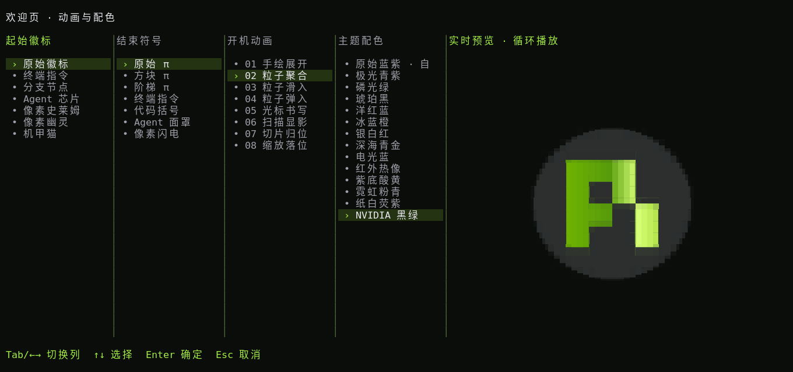

# Pi Welcome

给 [Pi](https://pi.dev/) 加一个全屏启动页。从像素标志变成 π 的几秒里，就可以用方向键选中上次的对话，按 Enter 接着聊。图形全部由终端字符绘制，不需要图片协议或 Nerd Font。


## 安装与下载

已在 Pi 1.5.0 的交互模式下测试。推荐用 Pi 从 GitHub 安装固定版本：

```sh
pi install git:github.com/gcy-hub/pi-welcome@v1.1.0
```

重新启动 `pi` 即可看到欢迎页。若已打开 Pi，可先执行 `/reload`，再输入 `/welcome`。

**离线安装：** 下载 [pi-welcome-1.1.0.zip](https://github.com/gcy-hub/pi-welcome/releases/download/v1.1.0/pi-welcome-1.1.0.zip)，解压到准备长期保留的目录，再从其上一级运行：

```sh
unzip pi-welcome-1.1.0.zip
pi install ./pi-welcome-1.1.0
```

本地路径安装会直接使用解压目录，请保留它。若之前已手动安装到 `~/.pi/agent/extensions/pi-welcome/`，请只保留一种安装方式，避免重复注册命令。卸载 GitHub 版本：`pi remove git:github.com/gcy-hub/pi-welcome@v1.1.0`。

## 选择会话


`/welcome` 或 `/pi-welcome` 可随时在空闲时打开欢迎页。会话按最近更新排序，优先显示 `/name` 设置的名称，否则显示首条消息。

| 按键 | 操作 |
|---|---|
| `↑` / `↓` | 移动直角高亮条。到首尾时循环选择，不轮转列表顺序 |
| `Enter` | 恢复选中的会话，或进入「+ 新建会话」 |
| `Esc` | 关闭欢迎页，保留当前会话 |

没有历史时不显示列表，`Enter` 和 `Esc` 都直接进入当前空白会话。通过 `--continue` 或 `--session` 启动时也会显示欢迎页；同一进程里切换会话或 `/reload` 不会重复弹出。

## 选择图标、动画与配色

输入 `/pi-welcome themes`，或按 `Enter` 跳过进入选择页前的开场。左侧从左到右是**起始徽标、结束符号、开机动画、主题配色**；改动任意一项，右侧都会从头播放新组合。窄窗口一次显示当前选择列，切列键不变。



| 图标位置 | 默认 | 可选形状 |
|---|---|---|
| 起始徽标 | 圆形 + π | 终端指令、分支节点、Agent 芯片、像素史莱姆、像素幽灵、机甲猫 |
| 结束符号 | π | 方块 π、阶梯 π、终端指令、代码括号、Agent 面罩、像素闪电 |

两端可独立更换，颜色由配色列决定。在原本没有圆徽标的动画中，选用自定义起始徽标会在原动画前加一段徽标消散。升级自 v1.0 时保留原动画和配色，不改变默认形状。

用 `Tab` 或 `←` / `→` 切换列，`↑` / `↓` 试选。`Enter` 保存并重播新组合，随后进入会话选择；`Esc` 取消本次修改。设置保存在 Pi 配置目录的 `pi-welcome.json`，不会修改聊天界面或终端的全局主题。

可自由组合 **8 个开场动画和 14 套配色**。默认是「粒子聚合 × 原始蓝紫」，图中使用「粒子聚合 × NVIDIA 黑绿」。另有纸白荧紫等浅色方案；[配色表与色卡](assets/Color/)列出了 13 套素材配色的 RGB 值，原始蓝紫随终端背景自适应。

## 开发

Pi 包入口为 `index.ts`。播放端只读取预制遮罩与配色，不需要 Python。修改 `assets/Anime/` 中的源 GIF 后，可用 `python3 tools/prepare-assets.py` 重建原动画（需 Pillow）；修改 `assets/icons/` 中的参考图后，用 `python3 tools/prepare-icons.py` 重建图标片段（需 Pillow 与 NumPy）。使用托管版 Pi 可运行 `node test.mjs`；`python3 tests/keyboard.py` 需要本机 Pi 已加载此插件，在 Linux 伪终端中验证键盘流程。
